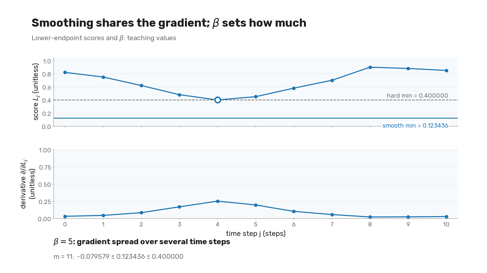
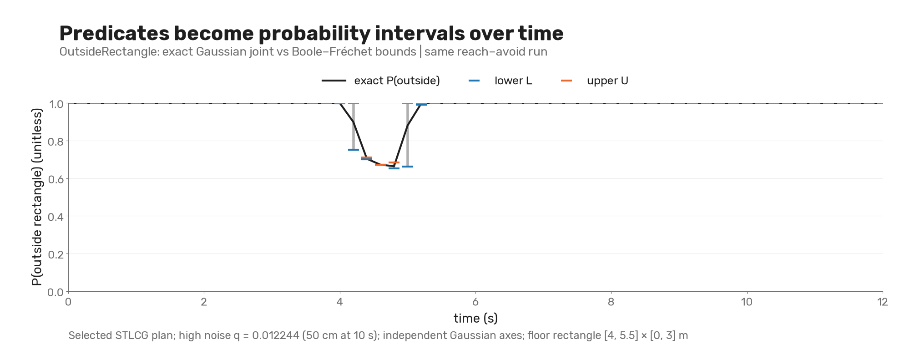
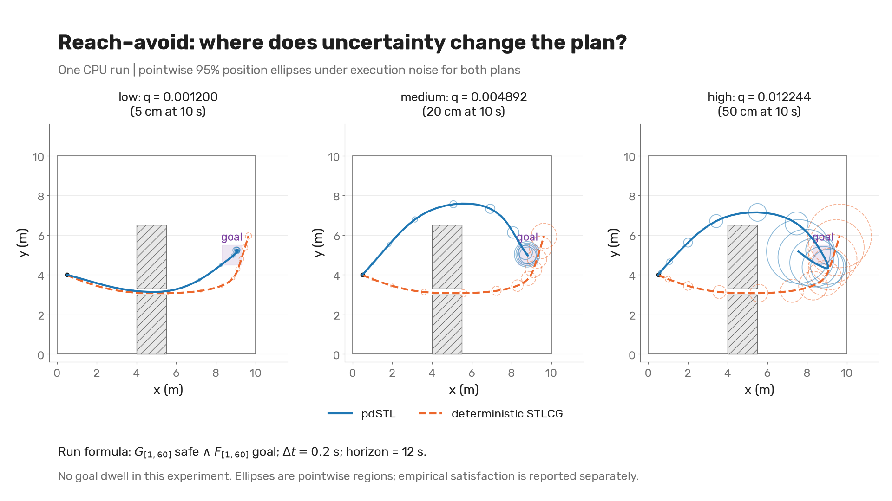

# ECEN 5773 pdSTL deck media

Bennett Dogbey · iHuman Lab · generated 16 November 2026.

Tasks C, A, B and E are complete. Crazyflie is excluded at the user's request. The optional original STLCG paper figure was not copied. Slide-deck editing was outside the requested media scope.

All plots use white backgrounds, Rubik text (minimum 23.6 px at 1920 wide), the requested blue/orange/purple/gray palette and mathtext for mathematical symbols. Animation axes stay fixed. All videos are H.264 MP4 with pause holds and a PNG for every stage plus the final frame. Task A uses the explicitly requested 2000×780 size; the other PNGs and videos are 1920×1080.

| Video | Duration | File size |
|---|---:|---:|
| [smoothing_window.mp4](smoothing_window.mp4) | 8.958 s | 0.138 MB |
| [register.mp4](register.mp4) | 13.500 s | 0.212 MB |
| [reach_avoid_optimizer.mp4](reach_avoid_optimizer.mp4) | 12.542 s | 0.231 MB |

Use [INVENTORY.md](INVENTORY.md) for **every filename and what it shows**, [manifest.json](manifest.json) for file hashes and [numeric_inventory.json](numeric_inventory.json) for **every number shown on screen** and its source. Each animation's `_final.png` is the fallback still for exported slides.

## Smoothing over a time window (priority C)



The supplied eleven scores and beta values are labeled “teaching values.” The derivative is a line with dots over time, with a 0–1 axis; it is never labeled probability. The unique hard minimum is 0.40 at j=4, with runner-up 0.45 at j=5. Stages: scores; hard minimum/spike; beta 5; beta 20; beta 100.

| beta | smin | Verified numeric bound, m=11 |
|---:|---:|---|
| 5 | 0.123436119870 | -0.079579054560 ≤ smin ≤ 0.400000000000 |
| 20 | 0.376088110068 | 0.280105236360 ≤ smin ≤ 0.400000000000 |
| 100 | 0.399929514742 | 0.376021047272 ≤ smin ≤ 0.400000000000 |

The calculation and autograd derivatives agree with `src/pdstl/operators.py:_reduce_bounds(Minish(), x, beta)` at the pinned main commit to floating-point precision. There is **no mismatch**. The smooth lower minimum is the **unnormalized** negative log-sum-exp; the normalized `Minish` result alone would be different. Stages before a beta is chosen show the numeric hard minimum and symbolic beta-dependent bound.

The complete derivative table is [smoothing_weights.md](smoothing_weights.md); [CSV](smoothing_values.csv) and [JSON](smoothing_values.json) retain full precision.

## Predicate bounds (A)



The repo has genuinely non-exact rectangular-event bounds. `pdstl.predicates.OutsideRectangle.robustness_trace` evaluates `Negation(And(AxisInterval, AxisInterval))`; `models.beliefs.GaussianBelief.probability` supplies exact Gaussian axis probabilities, and `pdstl.operators._conjunction` combines them using Boole–Fréchet rules.

The belief is **from the same fresh Task E run**: the selected STLCG plan under high evaluation noise, q=0.01224377 (50 cm position standard deviation at 10 s), at all 61 times over 0–12 s. The event is outside the run's floor obstacle `[4,5.5] × [0,3]` m. The linear-Gaussian dynamics preserve independence between the two axes, so the exact outside probability is `1-p_x*p_y`; the repo interval is `[1-min(p_x,p_y), min(1,2-p_x-p_y)]`. Every exact value lies in its interval. The black line is exact; blue/orange ticks mark L/U; gray segments connect bounds. [Complete means, covariances and event data](predicate_bounds.json). This replaces the digitized GIF belief with a reproducible experimental belief and uses its actual 12 s horizon.

## Shift register (B)

The video begins at `H_1=[r3;r2;r1]`. Rows visibly fade/translate between fixed slots, then r0 enters. The min readout is `[0.40,0.60]`; the same memory gives max `[0.90,0.95]`. The shift M is highlighted with row motion, and insertion e2 with the incoming row. Eight stills correspond to the requested eight stages. Every trace value, matrix entry and output is in the numeric inventory.

## Reach–avoid, one fresh run (E)



**Source:** `iHuman-Lab/probabilistic-dstl`, main commit `12b3bd7987faab130ebcf73120aeddbf77f17085`. A clean `git archive` was used, preserving the existing working branch and edits. Every source/config byte was checked against the commit; SHA-256 values are in [reach_avoid_run.json](reach_avoid_run.json).

**Command:** `PDSTL_DEVICE=cpu python deck_media/run_reach_avoid.py --source /tmp/pdstl-deck-main`

**Runtime:** 139.965 s, including all eight solves, iteration capture, and six Monte Carlo evaluations. **Seed:** 7. CPU, one Torch thread; Torch 2.7.0+cu128, NumPy 2.4.6; other versions in [environment.json](environment.json).

The runner invokes the same optimize/validate stages as the risk-aversion blocks in `src/main.py`, using `src/experiments/risk_aversion.py` and the unchanged YAML. It only adds passive iteration recording. Each of eight candidates has its initial theta plus all 600 post-update parameters from the planner's iteration hook. A wrapper copies the actual unconstrained parameters passed to the rollout; theta is **not reconstructed** from rounded controls. All 601 complete mean paths per solve are saved in the NPZ files.

**Formula mismatch:** the **built formula** is `G_[1,60] safe AND F_[1,60] goal` with 0.2 s steps and a 12 s horizon. Both windows begin at step **1**, and there is **no one-second stay-in-goal requirement**. The experiment module's comments describe windows beginning at 0; the actual `Environment.get_specification` result begins at 1, as confirmed by printing the built specification. The experiment code and all computed results were preserved. Report the slide as reach–avoid, or separately change/re-run the scientific experiment before claiming reach-and-stay results.

q denotes process-noise standard deviation in `Q=q²I`. The parenthesized 5/20/50 cm values are per-axis position standard deviations **after 10 s**, not at the 12 s horizon. The figure shows full-horizon paths and pointwise 95% Gaussian position ellipses (2-D chi-square threshold 5.9914645471) every 1 s for **both methods under the same evaluation noise**. These are individual-time regions. The STLCG planner itself is noise-free.

| Method | q (spread at 10 s) | Route | Planned score | Score under evaluation noise | MC successes | Empirical satisfaction (95% CI) |
|---|---|---|---:|---:|---:|---|
| stlcg | 0.00119988 (5 cm) | slit | 1.000000 | 0.931365 | 4858/5000 | 97.16% [96.66, 97.60] |
| stlcg | 0.00489236 (20 cm) | slit | 1.000000 | 0.301317 | 3031/5000 | 60.62% [59.25, 61.98] |
| stlcg | 0.01224377 (50 cm) | slit | 1.000000 | 0.000000 | 1581/5000 | 31.62% [30.33, 32.93] |
| pdstl | 0.00119988 (5 cm) | slit | 1.000000 | 1.000000 | 5000/5000 | 100.00% [99.93, 100.00] |
| pdstl | 0.00489236 (20 cm) | around | 0.997681 | 0.997681 | 4996/5000 | 99.92% [99.80, 99.98] |
| pdstl | 0.01224377 (50 cm) | around | 0.785426 | 0.785426 | 4785/5000 | 95.70% [95.10, 96.25] |

Each cell uses 5,000 rollouts with common random draws and 95% Clopper–Pearson confidence intervals. “Planned score” uses the planner's own model; the additional evaluation score re-scores each selected plan at that row's noise. Scores are **pdSTL robustness values, not trajectory satisfaction probabilities**. Empirical satisfaction is separately estimated from sampled trajectories. At high noise the pdSTL planned score is below its 0.99 target; no guarantee is implied.

The replay shows the selected high-noise pdSTL candidate at initial, 50, 150, 300, 450 and 600 updates, then its selected output. The selected iteration in this solve is 599 (600 completed updates), so the final two trajectories coincide. Both index and update count are displayed. All other candidates' iterates are also supplied.

## Recreate and verify

Install the project's dependencies and `imageio-ffmpeg==0.8.1` (the only extra runtime media dependency), then run:

```bash
PDSTL_DEVICE=cpu python deck_media/reproduce.py
python deck_media/build_report.py
```

The reproduction script archives the pinned commit into a temporary directory, runs the experiment, renders all assets and validates them. Re-running overwrites generated media/data in this folder. To check the supplied files without re-optimizing:

```bash
python deck_media/validate_media.py
```

Validation covers all smoothing bounds/derivatives, non-exact predicate containment, register calculations, every saved theta/control/path, selected-plan identity, Monte Carlo confidence intervals, every PNG size and complete decoding of all three MP4s. It also checks that videos end on their exported final frames. Results: [validation.json](validation.json). The pinned source's focused pdSTL/risk-aversion tests passed: **143 passed** (`PYTHONPATH=/tmp/pdstl-deck-main/src python -m pytest /tmp/pdstl-deck-main/tests/test_risk_aversion.py /tmp/pdstl-deck-main/tests/test_pdstl.py -m 'not slow' -q`).

Rubik comes from [Google Fonts](https://github.com/google/fonts/tree/main/ofl/rubik); weights 400 and 700 were instantiated from the bundled variable font. Redistribution terms: [Rubik-LICENSE.txt](Rubik-LICENSE.txt).
